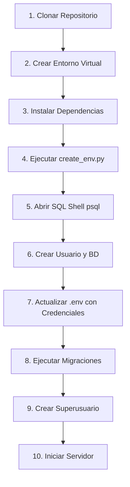

# PET FACE ID - Documentación Completa

> Sistema de Gestión Veterinaria con Reconocimiento Facial de Mascotas


---

## �📑 Índice

### 📦 [PARTE 1: GUÍA DE INSTALACIÓN](#parte-1-guía-de-instalación)
- [📌 Información Importante](#-información-importante)
- [Requisitos Previos](#requisitos-previos)
- [Instalación Paso a Paso](#instalación-paso-a-paso)
  - [Paso 1: Clonar el Repositorio](#paso-1-clonar-el-repositorio)
  - [Paso 2: Crear y Activar el Entorno Virtual](#paso-2-crear-y-activar-el-entorno-virtual)
  - [Paso 3: Instalar Dependencias](#paso-3-instalar-dependencias)
  - [Paso 4: Configurar Variables de Entorno](#paso-4-configurar-variables-de-entorno)
  - [Paso 5: Configurar la Base de Datos PostgreSQL](#paso-5-configurar-la-base-de-datos-postgresql)
  - [Paso 6: Probar la Conexión a la Base de Datos](#paso-6-probar-la-conexión-a-la-base-de-datos)
  - [Paso 7: Crear el Superusuario](#paso-7-crear-el-superusuario)
  - [Paso 8: Verificar el Proyecto](#paso-8-verificar-el-proyecto)
  - [Paso 9: Ejecutar el Servidor de Desarrollo](#paso-9-ejecutar-el-servidor-de-desarrollo)
- [📝 Resumen de Comandos](#-resumen-de-comandos)
- [❓ Solución de Problemas Comunes](#-solución-de-problemas-comunes)
- [❓ Preguntas Frecuentes (FAQ)](#-preguntas-frecuentes-faq)
- [📋 Flujo de Configuración Resumido](#-flujo-de-configuración-resumido)
- [⚠️ Notas Importantes](#️-notas-importantes)
- [🔧 Comandos Útiles](#-comandos-útiles)

### 🚀 [PARTE 2: GUÍA DE EJECUCIÓN](#parte-2-guía-de-ejecución)
- [1. Ejecutar en Puerto Predeterminado (8000)](#1-ejecutar-en-puerto-predeterminado-8000)
- [2. Ejecutar en Puerto Personalizado](#2-ejecutar-en-puerto-personalizado)
- [3. Detener el Servidor](#3-detener-el-servidor)
- [4. Comandos Rápidos de Ejecución](#4-comandos-rápidos-de-ejecución)
- [5. Consejos de Ejecución](#5-consejos-de-ejecución)

### 📖 [PARTE 3: MANUAL DE USUARIO](#parte-3-manual-de-usuario)
- [🚀 Acceso al Sistema](#-acceso-al-sistema)
- [👥 Registro de Usuarios](#-registro-de-usuarios)
- [🐾 Registrar Mascota](#-registrar-mascota)
- [✏️ Editar Mascota](#️-editar-mascota)
- [🎯 Reconocimiento Facial](#-reconocimiento-facial)
- [🎨 Funcionalidades Extra](#-funcionalidades-extra)
- [💡 Consejos Importantes](#-consejos-importantes)
- [🆘 Errores Comunes](#-errores-comunes)

---

# 📦 PARTE 1: GUÍA DE INSTALACIÓN

> Complete la instalación y configuración inicial del sistema

---

## 📌 Información Importante

Este proyecto **NO incluye el archivo `.env` en el repositorio** por razones de seguridad. En su lugar, incluimos un script automatizado (`create_env.py`) que genera todas las variables de entorno necesarias con valores seguros.

### ¿Qué hace `create_env.py`?

✅ Genera una `SECRET_KEY` única y segura automáticamente  
✅ Crea todas las variables de entorno necesarias  
✅ Permite actualizar el archivo sin perder configuraciones existentes  
✅ Incluye un modo `--status` para verificar tu configuración  

---

## Requisitos Previos

Antes de comenzar, asegúrate de tener instalado:

| Software | Versión Mínima | Enlace de Descarga |
|----------|----------------|-------------------|
| **Python** | 3.10+ | [python.org](https://www.python.org/downloads/) |
| **PostgreSQL** | 14+ | [postgresql.org](https://www.postgresql.org/download/) |
| **Git** | 2.0+ | [git-scm.com](https://git-scm.com/downloads) |

### Verificar Instalaciones

```bash
python --version
psql --version
git --version
```

---

## Instalación Paso a Paso

### **Paso 1:** Clonar el Repositorio

```bash
git clone https://github.com/LuisArguello1/Veterinaria.git
```
```bash
cd Veterinaria
```


---

### **Paso 2:** Crear y Activar el Entorno Virtual

#### En Windows (CMD):
```cmd
python -m venv venv
```
```cmd
cd venv/scripts
```
```cmd
activate
```

#### En Linux/Mac:
```bash
python3 -m venv venv
source venv/bin/activate
```

> 💡 **Nota:** Verás `(venv)` al inicio de tu terminal cuando esté activado correctamente.

---

### **Paso 3:** Instalar Dependencias

Con el entorno virtual activado, instala todas las dependencias del proyecto:

```bash
pip install -r requirements.txt
```

**Dependencias principales:**
- Django 5.2.6 (Framework web)
- psycopg2 (Conexión PostgreSQL)
- OpenCV (Reconocimiento facial)
- Django Tailwind (Estilos CSS)
- Pillow, NumPy (Procesamiento de imágenes)

Este proceso puede tomar algunos minutos...

---

### **Paso 4:** Configurar Variables de Entorno

El proyecto necesita variables de entorno para funcionar correctamente. Hemos incluido un script automatizado que genera todas las variables necesarias.

#### 🔧 Generar el archivo `.env`

Ejecuta el script para crear el archivo `.env` con todas las variables necesarias:

```bash
python create_env.py
```

**Salida esperada:**
```
📝 Creando nuevo archivo .env...
✅ Archivo .env creado exitosamente.
⚠️  Edita los valores placeholder con tu configuración real.
```

Este script genera automáticamente:
- 🔑 `SECRET_KEY` única y segura para Django
- 🗄️ Variables de configuración de base de datos
- 📧 Configuración de email 
- ☁️ Configuración de Azure Storage 
- 🗺️ Token de Mapbox 
- 🤖 Configuración de Chatbot 

> 💡 **Tip:** Usa `python create_env.py --status` para verificar el estado de tu configuración en cualquier momento.

---

### **Paso 5:** Configurar la Base de Datos PostgreSQL

Ahora crearemos la base de datos y el usuario de PostgreSQL mediante comandos SQL.

#### 🗄️ Abrir SQL Shell (psql)

**1.** Ve al **menú Inicio** de Windows y escribe:
   ```
   SQL Shell (psql)
   ```

**2.** Ábrelo y te pedirá los siguientes datos. Presiona **Enter** en los primeros cuatro para usar los valores por defecto:

```plaintext
Server [localhost]: ⏎ Enter
Database [postgres]: ⏎ Enter
Port [5432]: ⏎ Enter
Username [postgres]: ⏎ Enter
Password for user postgres: ******** (aquí sí escribe tu contraseña)
```

**3.** Ingresa la **contraseña** que configuraste durante la instalación de PostgreSQL.

**4.** Una vez dentro, verás el prompt de PostgreSQL:
```sql
postgres=#
```

🎉 ¡Ya estás dentro del shell de PostgreSQL!

#### 📝 Ejecutar los comandos SQL

Una vez dentro del shell, ejecuta los siguientes comandos **uno por uno** (copia, pega y presiona Enter):

**Comando 1:** Crear el usuario de la base de datos
```sql
CREATE USER veterinaria_user WITH PASSWORD '12345';
```
✅ **Salida esperada:** `CREATE ROLE`

**Comando 2:** Crear la base de datos
```sql
CREATE DATABASE veterinaria WITH OWNER = veterinaria_user ENCODING = 'UTF8' LC_COLLATE = 'es_ES.UTF-8' LC_CTYPE = 'es_ES.UTF-8' TEMPLATE = template0;
```
✅ **Salida esperada:** `CREATE DATABASE`

> 💡 **Nota:** Si obtienes un error sobre `LC_COLLATE` o `LC_CTYPE`, usa esta versión simplificada:
> ```sql
> CREATE DATABASE veterinaria WITH OWNER = veterinaria_user ENCODING = 'UTF8';
> ```

**Comando 3:** Otorgar permisos al usuario
```sql
GRANT ALL PRIVILEGES ON DATABASE veterinaria TO veterinaria_user;
```
✅ **Salida esperada:** `GRANT`

#### ✅ Verificar la creación

Puedes verificar que todo se creó correctamente:

**1. Listar bases de datos:**
```sql
\l
```
📋 Deberías ver `veterinaria` en la lista con owner `veterinaria_user`

**2. Ver usuarios (roles):**
```sql
\du
```
👤 Deberías ver `veterinaria_user` en la lista de roles

**3. Salir del shell:**
```sql
\q
```

Esto te devolverá al prompt normal de PowerShell/CMD.

#### 🔗 Actualizar el archivo `.env`

Ahora que la base de datos está creada, actualiza las credenciales en el archivo `.env`:

**1.** Abre el archivo `.env` en la raíz del proyecto (puedes usar VS Code, Notepad, etc.)

**2.** Busca la sección `# DATABASE` y actualiza los valores:

```env
# DATABASE
DB_NAME=veterinaria
DB_USER=veterinaria_user
DB_PASSWORD=12345
DB_HOST=localhost
DB_PORT=5432
```

**3.** Guarda el archivo (Ctrl + S)

> ⚠️ **Importante:** Estos valores deben coincidir **exactamente** con los que usaste en los comandos SQL:
> - Si cambiaste el nombre de usuario → actualiza `DB_USER`
> - Si cambiaste la contraseña → actualiza `DB_PASSWORD`
> - Si cambiaste el nombre de la base de datos → actualiza `DB_NAME`

**Ejemplo del archivo `.env` completo:**
```env
# Variables de entorno - Generado/Actualizado: 2025-11-08 10:30:00

# DJANGO
SECRET_KEY=tu_secret_key_generada_automaticamente
DEBUG=True
BASE_URL=http://localhost:8000

# DATABASE
DB_NAME=veterinaria
DB_USER=veterinaria_user
DB_PASSWORD=12345
DB_HOST=localhost
DB_PORT=5432

# AZURE STORAGE
AZURE_ACCOUNT_NAME=tu_account_azure
AZURE_ACCOUNT_KEY=tu_key_azure
AZURE_CONTAINER=media

# EMAIL
EMAIL_HOST=smtp.gmail.com
EMAIL_PORT=587
EMAIL_HOST_USER=tu_correo
EMAIL_HOST_PASSWORD=tu_contraseña
EMAIL_USE_TLS=True
DEFAULT_FROM_EMAIL=tu_correo

# SECURITY
SECURE_SSL_REDIRECT=False
SESSION_COOKIE_SECURE=False
CSRF_COOKIE_SECURE=False

# CHATBOT
CHATBOT_IDENTITY_SECRET=tu_api_chatbot
DJANGO_SETTINGS_MODULE=config.settings

# MAPBOX
MAPBOX_TOKEN=tu_token_mapbox
```
---

### **Paso 6:** Probar la Conexión a la Base de Datos

Antes de continuar, vamos a verificar que la conexión a la base de datos funcione correctamente realizando las migraciones.

#### Generar y aplicar migraciones

**Comando 1:** Generar migraciones
```bash
python manage.py makemigrations
```

**Salida esperada:**
```
Migrations for 'autenticacion':
  apps\autenticacion\migrations\0001_initial.py
    - Create model Usuario
    ...
Migrations for 'mascota':
  apps\mascota\migrations\0001_initial.py
    - Create model Mascota
    ...
```

**Comando 2:** Aplicar migraciones
```bash
python manage.py migrate
```

**Salida esperada:**
```
Operations to perform:
  Apply all migrations: admin, auth, autenticacion, contenttypes, mascota, sessions
Running migrations:
  Applying contenttypes.0001_initial... OK
  Applying auth.0001_initial... OK
  Applying autenticacion.0001_initial... OK
  Applying mascota.0001_initial... OK
  ...
```

✅ **Si ves estos mensajes con "OK", ¡la conexión funciona correctamente!**

❌ **Si ves errores:** Revisa que las credenciales en `.env` coincidan con las de PostgreSQL y que PostgreSQL esté corriendo.

---

### **Paso 7:** Crear el Superusuario

Ejecuta el script personalizado para crear el superusuario:

```bash
python createsuperuser.py
```

**Credenciales por defecto:**
- 👤 **Usuario:** Admin
- 📧 **Email:** admin@gmail.com
- 🔑 **Contraseña:** admin123

> 💡 **Nota:** Si el usuario ya existe, el script te mostrará la información actual sin crear uno nuevo.

---

### **Paso 8:** Verificar el Proyecto

Ejecuta el siguiente comando para verificar que no hay errores de configuración:

```bash
python manage.py check
```

**Salida esperada:**
```
System check identified no issues (0 silenced).
```

✅ Si ves este mensaje, ¡todo está configurado correctamente!

---

### **Paso 9:** Ejecutar el Servidor de Desarrollo

Inicia el servidor de desarrollo de Django:

```bash
python manage.py runserver
```

**Salida esperada:**
```
Watching for file changes with StatReloader
Performing system checks...

System check identified no issues (0 silenced).
November 08, 2025 - 10:30:00
Django version 5.2.6, using settings 'config.settings'
Starting development server at http://127.0.0.1:8000/
Quit the server with CTRL-BREAK.
```

✅ **¡Instalación completada exitosamente!**

> 🚀 **Para más opciones de ejecución** (puertos personalizados, troubleshooting, etc.), consulta la [**PARTE 2: GUÍA DE EJECUCIÓN**](#parte-2-guía-de-ejecución)

---

## 🌐 Acceder al Sistema

Una vez iniciado el servidor, puedes acceder a:

### Aplicación Principal
```
http://127.0.0.1:8000/
```

### Panel de Administración
```
http://127.0.0.1:8000/admin/
```
**Credenciales iniciales:**
- 📧 **Email:** `admin@gmail.com`
- 🔑 **Contraseña:** `admin123`

> 📖 **Para aprender a usar el sistema**, consulta la [**PARTE 3: MANUAL DE USUARIO**](#parte-3-manual-de-usuario)

---

## 📝 Resumen de Comandos

### Comandos de Terminal (PowerShell/CMD)

```bash
# 1. Clonar repositorio
git clone https://github.com/LuisArguello1/Veterinaria.git
cd Veterinaria

# 2. Crear y activar entorno virtual
python -m venv venv
cd venv/scripts
activate

# 3. Instalar dependencias
pip install -r requirements.txt

# 4. Generar archivo .env
python create_env.py
```

### Comandos SQL (SQL Shell - psql)

```sql
-- 5. Crear usuario
CREATE USER veterinaria_user WITH PASSWORD '12345';

-- 6. Crear base de datos
CREATE DATABASE veterinaria WITH OWNER = veterinaria_user ENCODING = 'UTF8' LC_COLLATE = 'es_ES.UTF-8' LC_CTYPE = 'es_ES.UTF-8' TEMPLATE = template0;

-- Si da error, usar esta versión:
-- CREATE DATABASE veterinaria WITH OWNER = veterinaria_user ENCODING = 'UTF8';

-- 7. Otorgar permisos
GRANT ALL PRIVILEGES ON DATABASE veterinaria TO veterinaria_user;

-- 8. Verificar creación
\l
\du

-- 9. Salir
\q
```

### Continuar en Terminal

```bash
# 10. Editar .env con las credenciales de la base de datos
# Actualizar: DB_NAME, DB_USER, DB_PASSWORD

# 11. Probar conexión con migraciones
python manage.py makemigrations
python manage.py migrate

# 12. Crear superusuario
python createsuperuser.py

# 13. Verificar proyecto
python manage.py check

# 14. Ejecutar servidor
python manage.py runserver
```

---

## ❓ Solución de Problemas Comunes

### 🔴 Error: "No module named 'django'"

**Causa:** El entorno virtual no está activado o las dependencias no se instalaron.

**Solución:**
```bash
cd venv\Scripts
activate

pip install -r requirements.txt
```

---

### 🔴 Error de conexión a PostgreSQL

**Causa:** PostgreSQL no está corriendo o las credenciales en `.env` son incorrectas.

**Solución:**
1. Verifica que PostgreSQL esté corriendo
2. Confirma que las credenciales en `.env` coincidan con las usadas en SQL Shell:
   - `DB_NAME=veterinaria`
   - `DB_USER=veterinaria_user`
   - `DB_PASSWORD=12345`
3. Verifica la conexión ejecutando `python manage.py migrate`

---

### 🔴 Error: "SECRET_KEY not found" o falta el archivo `.env`

**Causa:** El archivo `.env` no existe o está incompleto.

**Solución:**
```bash
python create_env.py
```
Luego edita el archivo `.env` generado con tus credenciales de base de datos.

---

### 🔴 Error: "database does not exist" durante las migraciones

**Causa:** La base de datos no fue creada correctamente en PostgreSQL.

**Solución:**
1. Abre SQL Shell (psql) nuevamente
2. Verifica que la base de datos existe: `\l`
3. Si no existe, ejecuta los comandos CREATE del **Paso 5**

---

### 🔴 Error: "El usuario 'admin' ya existe"

**Causa:** Ya ejecutaste el script `createsuperuser.py` anteriormente.

**Solución:** Este no es un error, el script simplemente te informa que el usuario ya existe. Puedes usar las credenciales existentes para iniciar sesión.

---

### 🔴 Error: "LC_COLLATE" o "LC_CTYPE" no disponible en PostgreSQL

**Causa:** La configuración regional `es_ES.UTF-8` no está disponible en tu instalación de PostgreSQL en Windows.

**Solución:** Usa el comando CREATE DATABASE simplificado:
```sql
CREATE DATABASE veterinaria WITH OWNER = veterinaria_user ENCODING = 'UTF8';
```

---
## ❓ Preguntas Frecuentes (FAQ)

### ¿Por qué no está el archivo `.env` en el repositorio?

Por seguridad. El archivo `.env` contiene información sensible como claves secretas y contraseñas. Incluimos el script `create_env.py` para que cada desarrollador genere su propio archivo con sus credenciales locales.

### ¿Puedo cambiar las credenciales de la base de datos?

Sí, puedes usar las credenciales que prefieras, pero deben coincidir exactamente entre:
- Los comandos SQL en PostgreSQL
- Las variables en el archivo `.env`

### ¿Qué hago si ya tenía un archivo `.env`?

El script `create_env.py` es inteligente:
- Si NO existe `.env` → Lo crea desde cero
- Si YA existe `.env` → Solo agrega variables faltantes, manteniendo tus valores existentes
- Crea un backup automático antes de cualquier cambio

### ¿Cómo verifico que mi configuración está correcta?

```bash
python create_env.py --status
```

Este comando te mostrará qué variables están configuradas, cuáles tienen valores placeholder y cuáles faltan.

---

## 👥 Soporte

Si encuentras algún problema durante la instalación:

1. Revisa la sección **Solución de Problemas Comunes**
2. Verifica que todos los requisitos previos estén instalados
3. Usa `python create_env.py --status` para diagnosticar problemas de configuración
4. Consulta con el equipo de desarrollo del proyecto

---

## 📋 Flujo de Configuración Resumido



---

## ⚠️ Notas Importantes

- 🔒 **El archivo `.env` NO está incluido en el repositorio** por motivos de seguridad. Usa `create_env.py` para generarlo
- 🗄️ **Credenciales por defecto de la base de datos:**
  - Usuario: `veterinaria_user`
  - Contraseña: `12345`
  - Base de datos: `veterinaria`
- ✅ Las credenciales deben coincidir entre SQL Shell y el archivo `.env`
- ✅ Asegúrate de tener PostgreSQL corriendo antes de las migraciones
- ✅ Usa `python createsuperuser.py` en lugar de `manage.py createsuperuser`
- ✅ Ejecuta `python manage.py check` antes de iniciar el servidor
- ✅ Los modelos de IA están en la carpeta `/models/`
- 💡 Usa `python create_env.py --status` para verificar tu configuración en cualquier momento

---

## 🔧 Comandos Útiles

| Comando | Descripción |
|---------|-------------|
| `python create_env.py` | Genera o actualiza el archivo `.env` |
| `python create_env.py --status` | Muestra el estado de las variables de entorno |
| `python manage.py check` | Verifica la configuración del proyecto |
| `python manage.py makemigrations` | Genera nuevas migraciones |
| `python manage.py migrate` | Aplica migraciones a la base de datos |
| `python createsuperuser.py` | Crea el usuario administrador |
| `python manage.py runserver` | Inicia el servidor de desarrollo |

---
---

<div align="center">

# 🚀 PARTE 2: GUÍA DE EJECUCIÓN

> Aprende a ejecutar y administrar el servidor de desarrollo

</div>

---

Una vez completada la instalación, puedes ejecutar el proyecto de diferentes maneras según tus necesidades.

---

## **1. Ejecutar en Puerto Predeterminado (8000)**

Esta es la forma más común de ejecutar el servidor de desarrollo:

```bash
python manage.py runserver
```

**Acceder a la aplicación:**
- 🌐 **URL:** `http://127.0.0.1:8000/`
- 🔗 **También funciona:** `http://localhost:8000/`

**Salida esperada:**
```
Watching for file changes with StatReloader
Performing system checks...

System check identified no issues (0 silenced).
November 08, 2025 - 10:30:00
Django version 5.2.6, using settings 'config.settings'
Starting development server at http://127.0.0.1:8000/
Quit the server with CTRL-BREAK.
```

---

## **2. Ejecutar en Puerto Personalizado**

Si el puerto 8000 está ocupado o prefieres usar otro puerto:

```bash
python manage.py runserver 8080
```

> 🔢 Puedes usar cualquier puerto disponible: `3000`, `5000`, `8080`, `9000`, etc.

**Ejemplos de puertos alternativos:**

```bash
# Puerto 3000
python manage.py runserver 3000

# Puerto 5000
python manage.py runserver 5000

# Puerto 9000
python manage.py runserver 9000
```

**Acceder a la aplicación:**
- 🌐 **URL:** `http://127.0.0.1:[PUERTO]/`
- **Ejemplo:** `http://127.0.0.1:8080/`

---

## **3. Detener el Servidor**

Para detener el servidor de desarrollo:

- **Windows (CMD/PowerShell):** Presiona `CTRL + C`
- **Linux/Mac:** Presiona `CTRL + C`

Verás un mensaje similar a:
```
Quit the server with CTRL-C.
^C
```

---

## **4. Comandos Rápidos de Ejecución**

| Comando | Descripción | URL de Acceso |
|---------|-------------|---------------|
| `python manage.py runserver` | Puerto predeterminado (8000) | `http://127.0.0.1:8000/` |
| `python manage.py runserver 3000` | Puerto personalizado (3000) | `http://127.0.0.1:3000/` |
| `python manage.py runserver 5000` | Puerto personalizado (5000) | `http://127.0.0.1:5000/` |
| `python manage.py runserver 8080` | Puerto personalizado (8080) | `http://127.0.0.1:8080/` |

---

## **5. Consejos de Ejecución**

✅ **Antes de ejecutar el servidor:**

```bash
# 1. Activa el entorno virtual (si no está activado)
cd venv\Scripts
activate

# 2. Verifica que no haya errores de configuración
python manage.py check

# 3. Aplica migraciones pendientes (si las hay)
python manage.py migrate

# 4. Ejecuta el servidor
python manage.py runserver
```

⚠️ **Problemas comunes al ejecutar:**

| Problema | Solución |
|----------|----------|
| `Error: That port is already in use` | Usa un puerto diferente: `python manage.py runserver 8080` |
| `No module named 'django'` | Activa el entorno virtual: `venv\Scripts\activate` |
| `OperationalError: connection refused` | Verifica que PostgreSQL esté corriendo |
| `DisallowedHost` | Agrega el host a `ALLOWED_HOSTS` en `settings.py` |

💡 **Tip:** Mantén el terminal abierto mientras uses la aplicación. Si lo cierras, el servidor se detendrá.

---
---

<div align="center">

# 📖 PARTE 3: MANUAL DE USUARIO

> Guía completa para usar todas las funcionalidades del sistema

</div>

---

## 🚀 Acceso al Sistema

Después de iniciar el servidor, accede a: `http://127.0.0.1:8000/`

### Opciones de Inicio de Sesión

**Método 1: Email y contraseña**
- 📧 Ingresa tu email
- 🔑 Ingresa tu contraseña
- Clic en **"Iniciar Sesión"**

**Método 2: Reconocimiento facial** (si está configurado)
- 👤 Clic en **"Iniciar con reconocimiento facial"**
- Permite acceso a la cámara
- Posiciona tu rostro frente a la cámara
- El sistema te identificará automáticamente

### Credenciales de Administrador

Para acceso inicial como administrador:
- 📧 **Email:** `admin@gmail.com`
- 🔑 **Contraseña:** `admin123`

---

## 👥 Registro de Usuarios

### Crear una Nueva Cuenta

1. Desde la página de inicio, clic en **"Registrarse"** o **"Crear cuenta"**
2. Completa el formulario con los siguientes datos:

**Datos requeridos:**
- 📧 **Email** (debe ser único)
- 👤 **Nombre completo**
- 📱 **Teléfono**
- 📍 **Dirección**
- 🔑 **Contraseña** (mínimo 8 caracteres)
- ✔️ **Confirmar contraseña** (debe coincidir)

3. Acepta los términos y condiciones
4. Clic en **"Registrarse"**
5. Serás redirigido automáticamente a tu dashboard

### Configuración Opcional

Después del registro, puedes:
- 🖼️ Subir foto de perfil
- 👤 Configurar reconocimiento facial desde tu perfil
- ✏️ Actualizar información personal

---

## 🐾 Registrar Mascota

### Acceder al Formulario

1. Desde tu dashboard, clic en **"Registrar Mascota"** o botón **➕**
2. Completa todos los campos requeridos

### Datos Requeridos

#### **Información Básica**

| Campo | Descripción | Validación |
|-------|-------------|------------|
| **Nombre** | Nombre de la mascota | Mínimo 2 caracteres |
| **Raza** | Raza del animal | Campo obligatorio |
| **Sexo** | Género | Opciones: Macho / Hembra |
| **Etapa de Vida** | Edad biológica | Cachorro / Adulto / Senior |

#### **Datos Físicos**

| Campo | Descripción | Rango Válido |
|-------|-------------|--------------|
| **Edad** | Edad del animal | 0 - 30 (años o meses según etapa) |
| **Peso** | Peso en kilogramos | 0.1 - 200 kg |
| **Color** | Color predominante | Campo obligatorio |
| **Estado Corporal** | Condición física | Delgado / Normal / Sobrepeso / Obeso |
| **Fecha de Nacimiento** | Fecha exacta o aproximada | Debe coincidir con edad (±3 meses) |

#### **Información Adicional**

| Campo | Descripción | Validación |
|-------|-------------|------------|
| **Características Especiales** | Marcas, señas particulares | Mínimo 5 caracteres |
| **Foto de Perfil** | Imagen de la mascota | Requerida, máx 5MB |

### Validaciones Automáticas

Al presionar **"Guardar"**, el sistema valida automáticamente todos los datos:

#### ✅ **Validación de Edad (0-30)**

Rango válido: 0 a 30 años (o meses para cachorros)

❌ **Ejemplo de error:**
```
⚠️ La edad debe estar entre 0 y 30 (ingresaste: 122)
```

#### ✅ **Validación de Peso (0.1-200 kg)**

Rango válido: 0.1 kg a 200 kg

❌ **Ejemplo de error:**
```
⚠️ El peso debe estar entre 0.1 kg y 200 kg (ingresaste: 12333 kg)
```

#### ✅ **Coherencia Edad/Fecha de Nacimiento (±3 meses)**

La edad ingresada debe corresponder con la fecha de nacimiento (margen de ±3 meses)

❌ **Ejemplo de error:**
```
⚠️ La edad (12 años) no coincide con la fecha de nacimiento (1 año y 0 meses)
```

### Indicadores Visuales de Error

Los campos con errores muestran:
- 🔴 **Borde rojo** alrededor del campo
- ⚠️ **Mensaje de error** específico debajo del campo
- 📋 **Instrucciones** de cómo corregir el error

---

## ✏️ Editar Mascota

### Modificar Información

1. Desde tu lista de mascotas, ubica la mascota a editar
2. Clic en el ícono ✏️ **"Editar"**
3. Modifica los datos necesarios
4. Clic en **"Guardar Cambios"**

### Proceso de Validación

El sistema valida automáticamente al guardar:
- ✅ Si todos los datos son correctos → Cambios guardados exitosamente
- ❌ Si hay errores → Se muestran mensajes específicos
- 🔄 Corrige los errores y guarda nuevamente

### Datos No Modificables

Algunos datos no pueden cambiarse después del registro:
- 🆔 ID único de la mascota
- 📅 Fecha de registro en el sistema
- 👤 Propietario (solo un administrador puede cambiar esto)

---

## 🎯 Reconocimiento Facial

### Configurar Biometría Facial

#### **Paso 1: Acceder al Registro Biométrico**

1. Accede a los detalles de tu mascota
2. Clic en **"Registrar Biometría"** o **"Configurar Reconocimiento Facial"**

#### **Paso 2: Subir Fotografías**

Necesitas subir **15-20 fotos** de diferentes ángulos:

**Ángulos recomendados:**
- 📸 **Frontal**: 5-7 fotos de frente
- 📸 **Lateral Izquierdo**: 4-5 fotos del lado izquierdo
- 📸 **Lateral Derecho**: 4-5 fotos del lado derecho
- 📸 **Ángulos adicionales**: 2-3 fotos desde arriba o abajo

**Requisitos de las fotos:**
- ✅ Buena iluminación (natural preferiblemente)
- ✅ Fondo uniforme o simple
- ✅ Mascota tranquila y enfocada
- ✅ Rostro completo visible
- ✅ Sin obstrucciones (sin juguetes, correas en la cara)
- ✅ Diferentes expresiones (boca abierta/cerrada, orejas arriba/abajo)

#### **Paso 3: Procesar y Guardar**

1. Una vez subidas las 15-20 fotos, clic en **"Procesar y Guardar"**
2. El sistema analizará las imágenes (puede tomar 1-2 minutos)
3. Recibirás confirmación de que la biometría fue registrada exitosamente

### Usar el Escáner Facial

#### **Para Identificar una Mascota**

1. Desde el menú principal, clic en **"Escáner Facial"** o **📷**
2. **Opción A:** Toma una foto en tiempo real con la cámara
3. **Opción B:** Sube una foto existente desde tu dispositivo
4. El sistema procesará la imagen y buscará coincidencias
5. Si la mascota está registrada, mostrará:
   - 📋 Información completa de la mascota
   - 👤 Datos del propietario
   - 📞 Opciones de contacto

#### **Contactar al Propietario**

Si encuentras una mascota perdida:
1. Usa el escáner facial para identificarla
2. El sistema mostrará los datos de contacto del propietario
3. Puedes llamar o enviar mensaje directamente desde la aplicación
4. El propietario recibirá una notificación automática

---

## 🎨 Funcionalidades Extra

### 📄 Generar Carnet Digital

1. Accede a los detalles de tu mascota
2. Clic en **"Generar Carnet"**
3. El sistema crea un carnet digital con:
   - 🖼️ Foto de la mascota
   - 📋 Datos principales (nombre, raza, edad)
   - 📱 QR code único
   - 👤 Datos de contacto del propietario

4. Opciones:
   - **Descargar PDF** para imprimir
   - **Compartir** digitalmente
   - **Escanear QR** para acceso rápido a la información

### 🔍 Buscar Mascotas

Funcionalidad de búsqueda avanzada:

```
Buscar por: Nombre | Raza | Color | Propietario
```

**Filtros disponibles:**
- 🐕 **Raza**: Filtra por raza específica
- 🎨 **Color**: Filtra por color predominante
- 📊 **Estado Corporal**: Delgado / Normal / Sobrepeso / Obeso
- 👤 **Propietario**: Busca mascotas de un dueño específico

### 📊 Dashboard con Estadísticas

Tu panel de control muestra:
- 📈 **Total de mascotas** registradas
- 🐾 **Mascotas por raza** (gráfico)
- 📅 **Registros recientes**
- 🔔 **Notificaciones** pendientes
- ⚠️ **Alertas** (vacunas, revisiones, etc.)

### 🔔 Sistema de Notificaciones

Recibe notificaciones automáticas sobre:
- ✅ Registro exitoso de mascota
- 👤 Biometría configurada correctamente
- 🔍 Tu mascota fue escaneada por alguien
- 📱 Alguien intentó contactarte
- 📅 Recordatorios personalizados

---

## 💡 Consejos Importantes

### ✅ Mejores Prácticas

#### **Para Registro de Mascotas:**
- 📸 Usa fotos claras y bien iluminadas
- ⚖️ Ingresa datos precisos (peso real, edad correcta)
- 📅 Verifica la coherencia entre edad y fecha de nacimiento
- 🖼️ Sube imágenes de buena calidad (no pixeladas)

#### **Para Reconocimiento Facial:**
- 📷 Sube 15-20 fotos (no menos)
- 🌞 Preferiblemente con luz natural
- 🎭 Diferentes ángulos y expresiones
- 🧹 Fondo simple y sin distracciones

#### **Para Búsqueda Efectiva:**
- 🔍 Usa palabras clave específicas
- 🎯 Combina filtros para mejores resultados
- 📝 Mantén la información actualizada

### ❌ Evitar

#### **Datos Incorrectos:**
- ⚠️ Peso: No uses valores como 0, 12333, o negativos
- ⚠️ Edad: No ingreses edades imposibles (122 años)
- ⚠️ Fecha: No pongas fechas futuras o muy antiguas

#### **Imágenes Inadecuadas:**
- ❌ Fotos mayores a 5MB (comprime antes de subir)
- ❌ Imágenes borrosas o mal iluminadas
- ❌ Fotos con múltiples animales (solo tu mascota)
- ❌ Imágenes con obstrucciones en el rostro

#### **Reconocimiento Facial:**
- ❌ Menos de 15 fotos (no funcionará correctamente)
- ❌ Todas las fotos del mismo ángulo
- ❌ Fotos con mala calidad o muy antiguas

---

## 🆘 Errores Comunes y Soluciones

| Error | Causa | Solución |
|-------|-------|----------|
| **Edad y fecha no coinciden** | Discrepancia mayor a 3 meses | Verifica que la edad ingresada corresponda con la fecha de nacimiento |
| **Peso inválido** | Fuera del rango 0.1-200 kg | Ingresa el peso real en kilogramos (ej: 15.5 kg) |
| **Imagen muy grande** | Archivo mayor a 5MB | Comprime la foto usando herramientas online o reduciendo resolución |
| **Pocas imágenes biométricas** | Menos de 15 fotos | Sube al menos 15 fotos de diferentes ángulos |
| **Error al procesar biometría** | Fotos de baja calidad | Asegúrate de usar fotos claras, bien iluminadas |
| **No se puede editar mascota** | Falta de permisos | Solo el propietario o admin puede editar |
| **Escáner no identifica** | Biometría no configurada | Primero configura la biometría con 15-20 fotos |
| **QR no funciona** | Carnet no generado | Genera el carnet digital primero |

### Soluciones Paso a Paso

#### **Error: "La edad no coincide con la fecha de nacimiento"**

```
Ejemplo: Edad ingresada = 12 años
         Fecha nacimiento = 06/11/2024 (1 año)
```

**Solución:**
1. Calcula la edad real desde la fecha de nacimiento
2. Ajusta la edad o la fecha para que coincidan (±3 meses es aceptable)
3. Guarda nuevamente

#### **Error: "Imagen muy grande"**

**Solución:**
1. Usa un compresor de imágenes online (ej: TinyPNG, Compressor.io)
2. O reduce la resolución en tu dispositivo antes de subir
3. Tamaño recomendado: 1-2 MB

#### **Error: "Reconocimiento facial no disponible"**

**Solución:**
1. Ve a detalles de tu mascota
2. Clic en **"Registrar Biometría"**
3. Sube 15-20 fotos de calidad
4. Espera a que el sistema procese
5. Ahora podrás usar el escáner

---

## 📞 Soporte y Contacto

Si tienes problemas no resueltos en esta guía:

1. 📧 **Contacta al administrador** del sistema
2. 📝 **Describe el error** con capturas de pantalla si es posible
3. 🔍 **Proporciona detalles**: qué intentabas hacer, qué pasó

---

## 📝 Información del Documento

| Información | Detalle |
|-------------|---------|
| **Versión del Manual** | 1.0 |
| **Última Actualización** | Noviembre 2025 |
| **Sistema** | PET FACE ID v1.0 |
| **Tecnologías** | Python 3.10+, Django 5.2.6, PostgreSQL 14+ |
| **Repositorio** | [github.com/LuisArguello1/Veterinaria](https://github.com/LuisArguello1/Veterinaria) |

---

<div align="center">

**¡Gracias por usar PET FACE ID!** 🐾

Sistema de Gestión Veterinaria con Reconocimiento Facial

[](https://www.python.org/)
[](https://www.djangoproject.com/)
[](https://www.postgresql.org/)

**[⬆ Volver al inicio](#pet-face-id---documentación-completa)**

</div>
